# dev1 plan — Pulse Studio research (Trend bot)

Team Masala, Grok hackathon. This PR owns departments **1–3 planning** plus the **shared client** and the **Research Trend bot**. Marketing (`dev1/marketing_bot/`) and the Orchestrator (`dev1/orchestrator/`) are separate PRs into `main`. Do not implement them here.

Product: **Pulse Studio**. A trend on X becomes merch (sticker, tee, poster). Demo payoff: something that did not exist at the start is for sale at the end. dev4's service on port **8810** is the bus. One shared dashboard at `GET /dashboard`. No ContextForge gateway. dev1 acks that contract (posted on PR #2).

## What this PR ships

| Piece | Path | Role |
|---|---|---|
| Plan + tasks | `dev1/PLAN.md`, `dev1/task.md` | Scope for depts 1–3. Marketing and Orchestrator tasks point at their own PRs. |
| Shared client | `dev1/common/` | Grok Responses API client and `POST /api/events` helper. |
| Trend bot | `dev1/trend_bot/` | Dept `research`. Emits `trend_spotted`. |

## Contract this bot implements

Confirmed by dev4: posting this event **or** calling `POST /api/pulse/start` starts the whole Pulse chain. dev4 stand-ins fill a later step only if that department has posted **no** event for about **8 seconds**. This bot posts immediately so research is not replaced by a stand-in.

`POST {DEPARTMENTS_BASE_URL}/api/events` (default `http://127.0.0.1:8810`):

```json
{
  "dept": "research",
  "task_id": "trend-ab12cd34",
  "actor": "dev1-trend",
  "status": "done",
  "summary": "Trend spotted: Tiny hat frogs",
  "mode": "mock",
  "output": {
    "kind": "trend_spotted",
    "trend": "Tiny hat frogs",
    "why": "People on X are drawing retro pixel frogs in tiny hats and asking for stickers, tees, and posters.",
    "source": "x"
  }
}
```

- Required trigger fields inside `output`: `trend`, `why`, `source` exactly `"x"`. `kind` is `"trend_spotted"` so the dashboard and the chain can both see it.
- `source` stays `"x"` on the stored backup too. The backup is a saved X trend, and the chain keys off `source: "x"`. Honesty is the `mode` field, plus `output.fallback: "backup_fixture"` when this process did not get a usable Grok reply.
- `mode` is `live` only after a real xAI Responses call returns a usable trend. No `XAI_API_KEY`, or a failed/unparsed call, is `mock`. Never the reverse.
- Do not send `ts`. The service sets it.
- Status is `done` (one of `queued`, `running`, `needs_approval`, `approved`, `rejected`, `done`, `failed`).
- No emails, phones, SSNs, or API keys in the event. The client redacts them before POST.

This PR does **not** call `/api/pulse/start`. The event is enough, and calling both would start the chain twice. `/api/pulse/start` is not on `main` yet.

Marketing's webhook is `http://127.0.0.1:8899/pulse`. Port **8899** is reserved for that bot. This PR does not bind it and does not register that webhook.

## Architecture

```mermaid
flowchart LR
  founder[Founder request] --> orch[Orchestrator PR]
  orch --> trend[Trend bot dept research]
  trend -->|"POST /api/events trend_spotted"| bus["departments :8810"]
  bus --> design[Design dev4]
  design --> qa[QA gate]
  qa --> launch[Sales and engineering dev2]
  launch --> mkt["Marketing bot :8899/pulse"]
  mkt --> ops[Ops order]
  ops --> fin[Finance margin]
```



Direct agent-to-agent messaging is the Orchestrator PR's job (a small HTTP hop between dept processes, mirrored onto the same event log). This bot only talks to the bus. Other departments read `GET /api/events?dept=research` or `GET /api/stream`. Webhooks on 8810 fire for `approved`/`rejected`, routed `queued` tasks, and `done` events whose `output.action` is an object. `trend_spotted` is not one of those, so consumers must poll or watch the stream. The chain itself is server-side and does not need a webhook.

Dashboard tile **research** leaves "not connected" once this event is in the log (`dept: "research"`). Tile **orchestrator** stays dark until that PR posts `dept: "orchestrator"`. dev4 will stand in after ~8s if it does not.

## Trend bot

1. If `XAI_API_KEY` is set, `POST https://api.x.ai/v1/responses` with `GROK_TEXT_MODEL` (default `grok-4`, the team default) and tools `x_search` and `web_search`. The host is fixed. Model names must start with `grok-`. No `stop`, `presence_penalty`, or `frequency_penalty` (reasoning models reject them).
2. Parse a JSON object `{"trend","why"}` from the reply.
3. Otherwise load `dev1/trend_bot/fixtures/backup_trend.json` and emit it with `mode: "mock"` and `fallback: "backup_fixture"`.
4. POST the event. The research tile updates from that row.

`GROK_FAST_MODEL` (default `grok-4`) is on the shared client for the other PRs. `GrokClient.respond(..., fast=True)` selects it. `GROK_IMAGE_MODEL` (default `grok-imagine-image-2.0`) is the only image model name. Design owns image generation. Every model call uses xAI at `https://api.x.ai/v1` with `XAI_API_KEY`. There is no other provider and no other host.

HTTP is `httpx` (`dev1/requirements.txt`). Mock mode is the default until a key is set.

## How to run

```bash
cd dev1
python -m pip install -r requirements.txt
python -m unittest discover -s tests

# one trend into a running departments service (port 8810)
python -m trend_bot
python trend_bot/smoke.py
```

Env (never commit the key):

| Variable | Default |
|---|---|
| `XAI_API_KEY` | empty → mock |
| `GROK_TEXT_MODEL` | `grok-4` |
| `GROK_FAST_MODEL` | `grok-4` |
| `GROK_IMAGE_MODEL` | `grok-imagine-image-2.0` |
| `DEPARTMENTS_BASE_URL` | `http://127.0.0.1:8810` |

Text calls go to `https://api.x.ai/v1/responses`. That host is not configurable.

`grok-4` is the team default. xAI retires that slug onto a newer model; set `GROK_TEXT_MODEL=grok-4.7` when the key is in place if you want the flagship. Import from `dev1` on `PYTHONPATH` (`from common.grok import GrokClient`).

## Tests

- No key: fixture trend, `mode=mock`, `source=x`, sender for Grok is not called, body has no `ts`.
- Live fake response: parsed trend, `mode=live`, request tools include `x_search`, no penalty fields.
- Live HTTP failure or unusable JSON: backup, `mode=mock`.
- `mode=live` without a key is coerced to `mock` before POST.
- Email, phone, SSN, and key-like strings are redacted.
- `python -m unittest discover -s tests` from `dev1/` (after `python -m pip install -r requirements.txt`). The provider scan fails if `dev1/` names another model host.

## Risks

- Backup uses `source: "x"` so the chain starts. `mode` and `fallback` are what mark it as not a live fetch. If dev4 treats `source` as proof of a live call, say so and we will split the fields.
- `/api/pulse/start` body is not in the repo yet. We did not guess it.
- No key in this environment, so the live xAI path is coded and unit-tested with a fake HTTP response, not called against api.x.ai.
- A second `python -m trend_bot` appends another task. That is a new trend, not a retry of the same `task_id`.
