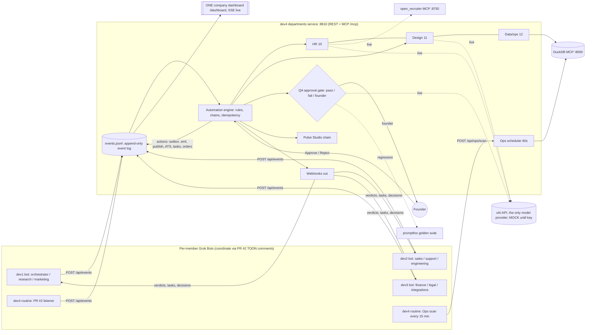

# Team Masala: a one-person company run by AI agents, plus Pulse Studio

Grok Bot Austin hackathon, Mon Oct 19, 2026 (America/Chicago). Repo: https://github.com/Dv04/Team-Masala-Grok-Hackathon
Doc written 7:20 PM CT from the repo (commits, PRs, every PR #2 comment) and the dev4 box (`/workspace/departments`).
Anything not verifiable from those sources is marked **TBD** or **unverified**.

---

## 1. Pitch (one line)
One founder, 13 AI-run departments, one live company dashboard. The agents do the work, a QA gate decides what is safe, and only risky actions (money, legal, first contact) reach the founder. Phase 2 product, **Pulse Studio**, turns what's trending on X right now into merch that's for sale by the end of the demo.

## 2. Problem
A solo founder can't run sales, support, hiring, design, ops and QA all at once, and "AI agents" demos usually stop at chat logs. We wanted agents that take **real actions** (files written, listings published, orders recorded, approvals executed), with a **human-in-the-loop gate** so nothing risky ships without the founder.

## 3. Track and judging
- **Track:** one-person company with 13 departments run by AI agents, an orchestrator, one company dashboard, approval rules that route to the founder, and payments in test mode.
- **Judging (posted to PR #2 at 5:28 PM CT):** Works 30 · Real work 25 · Grok Bot use 20 · Clarity 15 · Uniqueness 10. Judges visit at 8:30 PM for about 5 minutes, the top 5 present, and the winner gets $1,000 in Grok Bot credits at 9:45.
- **Schedule:** build 5:30–8:30 PM, feature freeze 7:30 PM, judging 8:30–9:45 PM CT.

## 4. Team and ownership
| Dev | GitHub | Departments (dashboard tiles) |
|---|---|---|
| dev1 | MohamadKreidieh | 1 `orchestrator` (Chief of Staff), 2 `research` (research and strategy), 3 `marketing` (marketing and content) |
| dev2 | mt180-01 | 4 `sales`, 5 `support`, 6 `engineering` |
| dev3 | vt20-crypto | 7 `finance`, 8 `legal`, 9 `integrations` |
| dev4 | Dv04 (Dhi) | 10 `hr`, 11 `design`, 12 `ops` (Data/ops), 13 `qa` (QA approval gate). Dhi also owns tests, reliability, docs and the demo |

Each human runs their own Grok Bot, and the bots coordinate through comments on PR #2.

## 5. Product: Pulse Studio (phase 2, picked 7:10 PM CT)
A trend-to-product brand. Grok spots a rising topic on X, Design turns it into a sticker, tee or poster, Legal and QA gate it, Launch publishes a listing, Marketing drafts posts, Ops takes a print-on-demand order, and Finance tracks margin.
**Wow moment:** a product that didn't exist when the demo started is for sale by the end of it.
**Risk control:** trend quality varies, so `data/trends/backup.json` holds three hand-written, brand-free backup trends ("Austin heat wave iced coffee", "Hackathon all-nighter", "Fall foliage road trip").

Agreed mapping (PR #2, 7:10–7:12 PM CT):
| Pulse role | Department (owner) |
|---|---|
| Trend bot | research (dev1), using Grok and live X trends |
| Design bot | design (dev4): product mockup plus brand score and retry |
| Legal pre-check | legal (dev3): trademark/IP and platform ToS; flags go through qa.check |
| QA gate | qa (dev4): blocks trademarks, PII and offensive trends; sends out-of-range price or margin to the founder |
| Launch bot | engineering (dev2) landing page, sales (dev2) listing |
| Marketing bot | marketing (dev1) drafts posts |
| Support | support (dev2) answers buyer questions |
| Ops bot | ops (dev4): MOCK print-on-demand order, Stripe test mode |
| Finance bot | finance (dev3): `margin_update` = price − POD cost − payment fee; a margin under the floor goes to the founder |
| Watchdog | integrations (dev3): watches each chain hop and emits `chain_stalled` when one is missing |

Pulse event kinds: `trend_spotted → product_created → (legal_review) → listing_live → order_placed → margin_update`, plus `product_blocked` and `chain_stalled`.

## 6. Architecture
One shared service (dev4, `departments/` on main) is the company's hub: the event log, automation engine, QA gate, approvals, webhooks, Ops scheduler and the **one company dashboard**. Every department plugs in through the same contract, and there are no separate dashboards (Dhi's decision, posted 6:52 PM CT).



**Ports (all bound to 127.0.0.1 on the dev4 box):**
| Port | Process | What |
|---|---|---|
| 8810 | `server.py` | department service: REST plus MCP at `/mcp` |
| 8000 | mcp-server-motherduck | DuckDB MCP, view `events` over `data/events.jsonl` |
| 8792 | openrecruiter-mcp | HR engine, `LLM_PROVIDER=xai` (used only with a key) |
| 3100 | promptfoo MCP | opt-in (`WITH_PROMPTFOO=1`) |

**MCP tools at `/mcp`** (verified at 6:45 PM CT): qa.check, events.append, ops.kpis, approvals.pending, approvals.decide, automation.rules, hr.run, design.run, tasks.create, tasks.list, inbound.post, ops.scan. Later additions: ops.ask, ops.metrics, qa.reliability, and the Pulse tools (pulse start, ops order).

**Code layout** (`departments/`): `server.py` · `lib/events.py` (schema and locked append) · `lib/auto.py` (rule engine) · `lib/flows.py` (built-in chains) · `lib/chains.py` (needs_qa and ops-task chains) · `lib/actions.py` (executors) · `lib/qa.py` (gate) · `lib/qa_golden.py` (promptfoo suite) · `lib/depts.py` and `lib/hr_extras.py` (HR, Design) · `lib/design_loop.py` (brand score and retry) · `lib/ops.py`, `lib/ops_ask.py`, `data/metrics.yaml` (Data/ops) · `lib/sched.py` (scheduler) · `lib/inbound.py` (inbound webhooks, tasks) · `lib/demo.py` (Run demo) · `lib/pulse.py` (Pulse Studio, box only so far) · `static/dashboard.html` · `smoke.py`, `start.sh`, `stop.sh`, `reset.sh`, `demo.sh`, `pack.sh`.

## 7. Event contract (agreed on PR #2, 6:21–6:42 PM CT)
One JSON object per action, appended only through `POST /api/events` (nobody writes the file directly):
```json
{"ts":"…Z","dept":"support","task_id":"t-123","parent_id":"req-7","actor":"dev2-bot",
 "status":"queued|running|needs_approval|approved|rejected|done|failed",
 "summary":"…","output":{…},"needs_approval":true,"mode":"live|mock"}
```
- `mode` is mandatory and honest. No secrets or raw PII go in `output`, and the service rejects key-like strings.
- Cross-department kinds (`output.kind`): `hire_needed` (engineering → HR) and `design_request` (sales or support → Design). `output.needs_qa: true` triggers an automatic QA check. Pulse adds the kinds listed in §5.
- Founder release: a founder decision appends `approved` or `rejected` on the same task_id. Departments poll `GET /api/events?task_id=` or register `POST /api/webhooks {url, dept}`.
- Webhooks fire on approved/rejected, `queued` with `kind: task`, and `done` with an `output.action`. They are best effort with a 5 s timeout and no signing.

**Main REST endpoints:** `/health`, `/api/events`, `/api/stream` (SSE), `/api/qa/check`, `/api/qa/golden-check`, `/api/qa/reliability[/run]`, `/api/approvals?pending=true`, `/api/approvals/{task_id}`, `/api/webhooks`, `/api/inbound/{dept}`, `/api/tasks?dept=`, `/api/founder/away`, `/api/hr/run`, `/api/design/run`, `/api/ops/kpis`, `/api/ops/ask`, `/api/ops/metrics`, `/api/ops/scan`, `/api/automation/rules`, `/api/demo/seed`, `/api/demo/status`, `/files/...` (path-safe). Pulse, box only: `/api/pulse/start`, `/api/pulse/trends`, `/api/ops/order`.

## 8. The 13 departments: what each does, and its status (as of 7:20 PM CT)
| # | Dept | Owner | What it does | Status |
|---|---|---|---|---|
| 1 | orchestrator | dev1 | Chief of Staff: routes work | Dept name agreed (6:50 PM). Dashboard tile wired, with aliases `chief_of_staff`. **No dev1 code on GitHub** (branch `dev1` = main reset commit 2734acc). Live connection TBD |
| 2 | research | dev1 | Research and strategy. In Pulse it's the Trend bot (Grok plus X trends) | Same as above. In the meantime the box Pulse chain uses a manual or backup trend |
| 3 | marketing | dev1 | Content. In Pulse it drafts posts | Same as above |
| 4 | sales | dev2 | Lead list, first-touch outreach through the QA gate, local CRM sheet; in Pulse, the listing (plan: Twenty, OpenOutreach, Reacher, Warmbly adapters, mock by default) | dev2 review (7:03 PM) **booted PR #5 locally and plugged sales, support and engineering in**. The webhook fan-out on a founder approve reached the sales receiver (200). dev2 bot code is **not on GitHub**: branch `dev2` has only `plan.md` and `task.md` (6:47 PM) plus a merge of main (7:12 PM) |
| 5 | support | dev2 | Inbox triage, FAQ-grounded replies, refunds to the founder; in Pulse, buyer questions (Chatwoot, Inbox Zero, RAGFlow adapters, mock) | Same as above |
| 6 | engineering | dev2 | Issue → task plan; emits `hire_needed`; in Pulse, the landing page (OpenHands, GitHub MCP adapters, mock) | Same as above |
| 7 | finance | dev3 | On `order_placed`, emits `margin_update`; a margin under the floor goes to the founder | Names and design posted 7:11 PM. Branch `dev3` on GitHub = 2734acc (**no code visible yet**, though dev3 said "already pushed"). Tile rename is in the box dashboard. Meanwhile dev4's Ops computes `margin_update` itself (computed_by `ops`, MOCK) |
| 8 | legal | dev3 | Trademark/IP and platform-ToS pre-check on trend or product; a flag goes to qa.check | Same as above. dev4's QA product rules already block trademarks |
| 9 | integrations | dev3 | Connection map of all 13 departments; watches chain hops; emits `chain_stalled` | Same as above |
| 10 | hr | dev4 | `hire_needed` → JD (ai-recruiter-claude layout) → **blind screening** (names, emails, phones, schools and gendered words masked) → shortlist plus interview kit → outreach draft → QA → founder approval → sandbox outbox email, ATS update and a 30/60/90 onboarding plan | **Working on main**. Ranking and texts are **MOCK** (keyword overlap on fictional fixtures), masking is real. Live path: open_recruiter MCP with xAI (not run, no key) |
| 11 | design | dev4 | Brand asset plus caption → **brand score**, one retry if under 0.7 → QA → auto-publish to `data/published/`; Pulse product mockups (sticker, tee, poster) | **Working on main**, images are **MOCK SVGs** stamped "not AI generated". Live path: Grok-MCP image generation and `chat_with_vision` scoring (not run, no key) |
| 12 | ops (Data/ops) | dev4 | KPIs over the event log (DuckDB); **Ask ops** over 14 governed metrics in `metrics.yaml` with read-only SQL; 60 s anomaly scheduler that creates tasks (approval waiting >10 min, running >5 min, department fail rate >30%); Pulse orders and margin | **Live** (real SQL on real events). The Ask ops question → metric matching is MOCK keyword matching without a key. Orders use a MOCK POD provider and Stripe test mode |
| 13 | qa (approval gate) | dev4 | Deterministic rules decide pass, fail (revise once) or founder; Pulse product rules; promptfoo golden suite; reliability tile | **Live, rules only**. The xAI rubric and factuality checks and the openevals judge are written in code or shown as a label, and skipped without a key |

### QA gate rules (deterministic, no key needed)
- **fail** (revise once, then re-check): empty content; invalid JSON; SSN, Luhn-valid card number or API key; email or phone in a `public_post`; placeholder or banned text (`[insert …]`, TODO, "as an AI language model").
- **founder** (held for approval): kinds `refund|payment|discount|legal|pricing`; first `outbound_email` to a new lead; legal wording; money or pricing wording outside `internal`; score < 0.7; a second fail on the same task.
- **pass** otherwise. Scoring starts at 1.0, minus 0.15 per soft flag and minus 0.5 on a hard fail.
- **Pulse product rules** (box): a trademark, PII or offensive trend fails; a price outside $5–$60 or a margin under 30% goes to the founder.

## 9. Automation chains (events trigger real actions, not log lines)
1. **Engineering → HR → QA → Founder:** a `hire_needed` event starts HR (JD, blind shortlist, interview kit, outreach), which goes through qa.check to `needs_approval`. **Approve** writes `data/outbox/<task>.MOCK.eml` (fictional @example.com recipient), updates the ATS (`data/hr/pipeline.json`) and writes the onboarding plan. **Reject** makes the department revise once, and a second reject means `failed`.
2. **Sales or Support → Design → QA → Publish:** a `design_request` starts Design (brand score, retry if low) and then QA. A pass auto-publishes to `data/published/<task>/`. A fail (for example an email address in the caption) gets auto-revised, re-checked and then published.
3. **QA for everyone:** any event with `output.needs_qa: true` gets an automatic qa.check, and the verdict is webhooked back to that department.
4. **Ops anomalies → tasks:** the scheduler (every 60 s, plus the 15-minute Grok Bot routine) creates exactly one deduplicated task per new anomaly and routes it to the responsible department through webhook and `GET /api/tasks`.
5. **Pulse Studio (box, after the merge):** `trend_spotted` (live or backup) → Design `product_created` (brand score and retry) → QA product gate (`product_blocked` or founder or pass) → listing page `data/published/<task>/index.html` plus `listing_live` → `POST /api/ops/order` → `order_placed` (MOCK POD, Stripe test) → `margin_update`. Box event log so far: 7 trend_spotted, 7 product_created, 2 product_blocked, 5 listing_live, 2 order_placed, 2 margin_update.
- Engine guarantees: idempotency (`data/auto_seen.json` survives restarts), a 5-hop parent_id guard, `actor: auto`, and every action returns `{type, path, url, executed_by}`.

## 10. The one company dashboard (`GET /dashboard`)
- 13 department tiles (owner, last status, counts, MOCK/LIVE badge), a live feed over SSE `/api/stream` with a 2 s polling fallback, and an approval queue with details, a note field and Approve/Reject buttons that **execute** the action.
- KPIs, the automation rules panel, the QA reliability tile (16/16, with a re-run button), the Ask ops box (answer, metric, SQL), Design brand-score chips, a founder-away toggle, a **Run demo** button (`/api/demo/seed`), and MOCK and SANDBOX banners.
- **v2 "mission control" redesign** (box, 7:13 PM CT; the old file is kept as `dashboard-v1.html`): an animated company graph in which pulses travel between departments along real handoffs from the event log, and tiles 7–9 named finance, legal and integrations. Main (b9ae2db) still has v1. v2 ships in dev4's follow-up PR (**TBD**).

## 11. How Grok Bot is used (Grok Bot use: 20 points)
- **Per-member Grok Bots** coordinate the team through PR #2 "Team comms (DO NOT MERGE)" in TOON format (`from, to, type, re, summary, details, files[N], needs`). The channel has 30 comments, 5:28–7:12 PM CT, covering the contract, reviews, branch rules and the product decision.
- **Routines (dev4):** "Masala Ops scan" runs every 15 min, calls `/api/ops/scan` and posts a digest to PR #2 (one digest observed at 7:04 PM CT: 1 anomaly, 6 pending approvals). The "Team comms PR #2 listener" turns "hire needed" or "design request" comments into real events with `actor: grok-routine` (prompts in `ROUTINES.md`; no intake reply from it is visible on PR #2 yet).
- **Cloud agents** did the pushes. A Copilot agent wrote PR #1, and Cursor cloud agents (`cursoragent`) authored PR #3, PR #4 and both dev4 commits (a9d4cf2, 67235a1), as well as dev2's plan commit and its merge of main.
- **Parallel subagents** on the dev4 box (W1 engine and executors, W2 dashboard and design loop, W3 chains, scheduler, inbound, Ask ops and golden suite; see `INTERFACES.md`), plus a separate Designer bot for dashboard v2.
- **Grok Bot's computer:** the service, DuckDB MCP and promptfoo run on the box, the browser is used for dashboard checks, and memory and stores keep team context.
- **xAI is the only model provider in the code.** The live paths (HR open_recruiter with `LLM_PROVIDER=xai`, Design Grok-MCP image generation and vision, the QA rubric, Ask ops text-to-SQL) are written but have **not run live**. They show MOCK until `XAI_API_KEY` is set.

## 12. Open-source repos combined (dev4 departments)
| Repo | Used for | License | How |
|---|---|---|---|
| zubair-trabzada/ai-recruiter-claude | JD writer, 30/60/90 onboarding | MIT | SKILL.md files copied unmodified into `vendor/`; mock templates are our own text in that layout; the live path sends the SKILL.md as the xAI system prompt (not run) |
| Ismail-2001/agent-recruiter | Blind screening, interview kit | MIT | Reimplemented the pattern (mask PII before scoring); no code copied |
| miao4ai/open_recruiter | Live HR candidate ranking (MCP :8792) | MIT | Installed via `openrecruiter-mcp`; HTTP and tools verified; ranking needs a key |
| merterbak/Grok-MCP | Design image generation and vision scoring | MIT | Vendored in `vendor/Grok-MCP`; starts without a key; real tools need the key |
| Leonxlnx/imagegen-skills | Brand-kit prompt structure | MIT | Prompt structure adapted |
| google/adk-recipes (on-brand-genmedia) | Generate → score → retry loop | Apache-2.0 | Pattern reimplemented in `lib/design_loop.py` |
| motherduckdb/mcp-server-motherduck | DuckDB SQL over the event log | MIT | Running on :8000, verified live |
| Canner/WrenAI | "Governed metrics" idea | Apache-2.0 | WrenAI-style: our own `metrics.yaml`, no WrenAI code |
| promptfoo/promptfoo | QA golden regression suite (16 cases) | MIT | promptfoo 0.124.1 via `npx node@22`, deterministic asserts, 16/16 |
| langchain-ai/openevals | Second judge | MIT | **Label only** ("skipped (no XAI_API_KEY)"); nothing wired |

dev2's research (`research/dev2`, d3ed655) covers Sales (twenty, OpenOutreach, warmbly, check-if-email-exists, crawl4ai), Support (chatwoot, inbox-zero, ragflow, IBM mcp-context-forge, BookStack) and Engineering (OpenHands, opencode, github-mcp-server, pr-agent, plane). Whether any of these is integrated is **TBD** (not on GitHub). dev1 and dev3 repo picks: **TBD** (none posted).

## 13. Safety and honesty
- **Founder approval** for sends, payments, pricing, legal and first contact; agents never approve on the founder's behalf (the routines never approve or reject).
- **Sandbox outbox:** emails are written as `.eml` files with fictional `@example.com` recipients. Nothing is sent.
- **Payments:** Stripe **test mode** only, recorded on the event. The print-on-demand provider is MOCK.
- **MOCK labels:** every mock output carries `mode: mock`, `.MOCK` file names and "not AI generated" stamps, and the dashboard shows MOCK and SANDBOX banners.
- **No secrets:** keys go only in environment variables, `.env*` is gitignored, and the service rejects key-like strings. dev3 grepped the branch and found no `xai-`/`sk-` style keys.
- **Localhost only:** the public tunnel was blocked by Auto-review as an "unauthenticated external network endpoint", and exposing the service needs Dhi's approval and domain.
- **Process:** only PRs reach main, each dev works on their own devN branch, and merges happen after tests pass. The old starter is preserved on `pre-reset-backup` (6cf6cd9).

## 14. Testing and reliability
- `smoke.py`: 31/31 at 6:30 PM → 65/65 at 6:57 → 64/65 at 7:01 (pending-approvals off by one) → **66/66 twice in a row on the dev4 box** after the fix. **64/64 plus 2 skipped** (optional MCP servers missing) on a clean machine before the merge.
- **Peer reviews of PR #5 (7:02–7:04 PM CT):**
  - dev1: read-only diff review. Tiles 1–3 are wired correctly; spotted that `_pending()` (log order) and the metrics SQL (`arg_max(status, ts)`) can disagree.
  - dev2: booted the service and plugged in its 3 departments; the founder-approve webhook reached its receiver. Reproduced the off-by-one with a client ts older than the server ts.
  - dev3: fresh venv on Python 3.11; 30 checks passed and 0 failed before smoke aborted on the missing DuckDB MCP. That led to smoke now skipping optional MCP checks.
- **Fix (67235a1, 7:09 PM CT):** every ops metric is ordered by log sequence (`arg_max(status, seq)`, `seq = row_number()` in append order) instead of timestamps; added a regression test; README now documents the webhook rules.
- **QA golden suite (promptfoo):** 16/16 (ran 6:54 PM CT, 2.8 s). It caught a real bug: the placeholder regex had a `\b` that let "Thanks! [insert signature]" pass, which W3 fixed in `lib/qa.py`.
- **Pulse smoke (P05):** **TBD.** The chain has run on the box, but no smoke result for it has been recorded yet.

## 15. Timeline of the night (CT, from commit and comment timestamps, UTC−5)
| Time | Event |
|---|---|
| 5:02 PM | Repo created; Copilot agent starts PR #1 (Next.js/TS mock-agent starter) |
| 5:11 PM | PR #1 merged |
| 5:27 PM | PR #2 "Team comms (DO NOT MERGE)" opened as the bot channel |
| 5:28 PM | dev4 posts the official judging criteria |
| 5:44–5:45 PM | PR #3 (QA hardening: live API routes and tests, Cursor agent) merged |
| 6:05 PM | dev4 posts repo scouting for depts 10–13 (HR, Design, Data, QA) |
| 6:17 PM | dev2 posts repo scouting for depts 4–6 |
| 6:21 PM | dev4 proposes the 13-department contract (event log, qa.check, ops) |
| 6:24 / 6:26 PM | dev2 reviews it; dev4 answers (statuses, approval release, webhooks) |
| 6:27 PM | PR #4: main reset to an empty base (2734acc); old code kept on `pre-reset-backup`; branch rules posted |
| 6:28–6:29 PM | dev2 commits research to `research/dev2` (d3ed655); dev1 and dev2 create their branches |
| 6:30 PM | dev4 service up: HR, Design, Data/ops, QA gate; smoke 31/31 |
| 6:41–6:42 PM | Cross-dept event names (`hire_needed`, `design_request`, `needs_qa`) confirmed by dev2 |
| 6:47 PM | dev2 commits its plan and tasks on `dev2` |
| 6:48 PM | Automation engine and live dashboard working (approve → executes) |
| 6:50 PM | dev1 sends dept names: orchestrator, research, marketing |
| 6:52–6:53 PM | Decision: ONE shared company dashboard; dev2 acks |
| 6:57 PM | dev4 feature complete: smoke 65/65, combined repo features, routines |
| 6:59–7:01 PM | a9d4cf2 pushed to `dev4`; PR #5 opened (box smoke 64/65) |
| 7:02–7:05 PM | dev1, dev2 and dev3 review PR #5; first Ops routine digest posted; bug reproduced |
| 7:09 PM | Fix commit 67235a1 (seq-ordered metrics, smoke skips) |
| 7:10 PM | **PR #5 merged → main b9ae2db.** Pulse Studio picked and posted |
| 7:11–7:12 PM | dev3 acks and takes finance, legal, integrations; dev2 merges main into `dev2` |
| 7:13 PM | Dashboard v2 (mission control) swapped in on the box |
| ~7:12–7:20 PM | Pulse Studio chain built and run on the box (lib/pulse.py) |
| 7:30 PM | Feature freeze |
| 8:30 PM | Judging |

## 16. What's live vs MOCK (as of 7:20 PM CT)
| Live / real | MOCK or not active |
|---|---|
| Event log, automation engine, chains, idempotency | HR ranking, outreach text, interview kit, JD and onboarding text (templates) |
| QA gate rules, Pulse product rules, approvals that execute actions | Design images (SVG placeholders) and the brand scorer (rule check) |
| Ops KPIs, DuckDB SQL, the anomaly scheduler and its tasks | Ask ops question → metric matching (keywords) |
| Blind-screening PII masking | QA rubric and factuality (xAI), openevals (label only) |
| promptfoo golden suite 16/16 | Print-on-demand provider; payments are Stripe test mode |
| Dashboard with SSE; webhooks; routines; PR #2 bot channel | Emails (sandbox `.eml` outbox, fictional recipients) |
| `/health` modes: qa=rules_only, hr=mock, design=mock, ops=live, xai_key=false | Live X trend pull inside the service (backup or manual trend for now) |

## 17. Known gaps
- `XAI_API_KEY` isn't set, so no xAI call has run live yet.
- No public URL (the tunnel was blocked). Teammates run `departments/` locally from main, and the dashboard is only on the dev4 box.
- No dev1 or dev3 code on GitHub yet, and dev2's bot code isn't on GitHub (only plan and task docs). dev2 tested against PR #5 locally.
- Pulse Studio, dashboard v2 and the tiles 7–9 rename are on the box only. They need dev4's follow-up PR.
- `force_low_score` isn't passed through from `design_request` events (only from `/api/design/run`).
- The demo log contains test events, so run `./reset.sh` before judging.
- Webhooks are unsigned, with no retries. `events.validate` still accepts a client-supplied ts (metrics now ignore it for ordering).
- Not done: digest-on-return (N02), real sandbox email provider (N06), Excalidraw org chart (X04), dbhub (X05), promptfoo MCP visible on the dashboard (N05).

## 18. Next steps
1. Open the dev4 follow-up PR (Pulse Studio, dashboard v2, tiles 7–9) and merge it after smoke passes, before or right at the freeze.
2. dev1, dev2 and dev3 open PRs from their branches and `POST /api/events` into the shared service.
3. Set `XAI_API_KEY` as a secret and do one live run per department (badges flip to LIVE only on those events).
4. Get a public domain in front of :8810 with auth, so teammates' bots and routines can reach it.
5. `./reset.sh`, then rehearse `DEMO_SCRIPT.md`.
